# Edit catalog: every reel style we've made, and how to remake it

**Purpose.** When a future brief says "do it like the split one", "the Tasmania one",
"that countdown reel", "the explainer with the window" or "Rahul's fast one", this
file says *which* edit that is, what it looks like, and what rebuilds it. It works
**without** the original `input/` or `work/` files. Those are deleted after delivery.
What survives in git, per reel: `content.json` (copy, timings, every overlay, with a
`_comment` that states the brief), `clips.json` (keep spans), `broll_plan.json`
(cuts/wipes, with its own `_comment`), and any per-reel code (`broll.py`,
`bg_swap.py`, `fx.py`, `text_behind.py`, `split.py`, `composite_take.py`, `take/`, …).
`edit-catalog/<reel>.jpg` is an 8-frame contact sheet of the delivered video
(evenly spaced, left to right).

**To remake a style on new footage:** copy the reference reel's config + per-reel
code into a new `reels/<date>_<slug>/`, drop new clips in `input/`, rewrite the
copy/anchors in `content.json` for the new script, then run the pipeline
(`reels/README.md`). Anchors in `content.json` are spoken words, not clock times, so
most overlays re-time themselves from the new transcript.

**Shared look across all reels (the house style):** 1080×1920, PFEC navy `#100796`
+ gold, Poppins; white PFEC logo pill top-centre; word-by-word captions with
the active word on a red/accent box (`caption_highlight`, `cap_top`); name + role
lower-third with MARN for RMAs only (`mara`); hero-word slams with whoosh+thud;
badges/chips; marker-swipe `highlights` on dates and times; `documents` (real poster/flyer
card); `zoom` punch-ins on emphasis; Tier-1 SFX; Kevin MacLeod bed with sidechain
ducking; the 7-office consultation end card + disclaimer card (`end_cards`).
Accent is one key (`accent`): cyan `#00B3E3` (default), green `#31EB7C` (desk reshoot).

---

## Edit types

### 1. Classic talking-head promo ("the standard one")
**Looks like:** presenter full-frame, captions bottom-third, hero words slam in,
badges and a poster card pop, a different brand wipe on each cut (speed/grid/flash),
end on the offices card.
**Recipe:** pure `content.json` + `broll_plan.json` (wipes, no code).
**Reference:** `2026-10-05_rahul-visa-changes` (four wipes, no neighbours alike),
`2026-10-05_tushar-visa-changes` (wipes on big beat changes, hard cuts around
short lines so wipes don't eat them).
**Rule baked in:** B-roll cutaways only over a connecting/filler phrase; if every
line carries information, use zero B-roll and wipes instead.

### 2. Event promo, high energy ("the expo ones", "Just Ask")
**Looks like:** type 1 plus motion-graphic stinger cutaways, city photos *behind*
the presenter, big date/time text behind the subject, the event flyer card.
**Signature code:** `cities_behind.py` / `bg_swap.py` (rembg cutout over a city
photo band, cut in sync with each city name), `date_behind.py`, `broll.py`
(HyperFrames stinger), `prep_searchmg.py` / `prep_matchcut.py` (normalise a
user-supplied clip into a cutaway).
**References:** `2026-08-13_salman-just-ask-expo` (v1), `-v2` (AI kinetic-multicam
take swapped in), `-v3` (hook removed; anchors keep everything in sync);
`2026-08-11_tushar-melbourne-expo` (match-cut clip + stinger);
`2026-08-07_maheesha-just-ask-expo` ("**countdown**": 3-2-1 reasons, giant
number slams, rapid Melbourne→Sydney→Adelaide background flash, `hero_3reasons.py`).
`2026-09-02_maheesha-welcome-day-sinhala`: spoken Sinhala with English subtitles
(`make_en_transcript.py`), five-city behind-subject snap sequence (`make_plates.py`),
real cruise photo card.

### 3. Fast jump-cut ("the fast one")
**Looks like:** one dense ~11 s take chopped into 5–6 segments; hard jump cuts with a
wide↔tight framing change *are* the style; wipes only on topic turns; huge type
baked behind the subject on the hook.
**Signature code:** `text_behind.py` (re-run after `build_base.py`).
**References:** `2026-10-12_tushar-fast`, `2026-10-15_rahul-189-round`.

### 4. Heavy-FX talking head ("the FX one", "velocity/whip-zoom one")
**Looks like:** virtual camera zooms to different parts of the frame, kinetic
text, text *and* photos behind the subject, scribble/hand-drawn marks, velocity
whip-zooms instead of wipes, parallax B-roll scenes.
**Signature code:** `fx.py` bakes it all into `work/segments/` (idempotent; keeps
clean copies in `segments_orig/`), `broll.py` for parallax + velocity-ramp
HyperFrames cutaways. Sourced photos credited in `assets/photos/CREDITS.txt`.
**References:** `2026-10-16_rahul-reel` (NSW unit groups, Hinglish → English
captions), `2026-10-21_rahul-img0082` (190 round, photo cards).

### 5. Split format ("the split one", "half-and-half")
**Looks like:** top 940 px is a continuous animated panel (torn-paper cards,
washi tape, polaroid photos, points callouts, the round's numbers), presenter in the
bottom 980 px with slammed caption words; torn-paper wipes between takes.
**Signature code:** `top_take/comp.html` (pfec-longtake comp synced to the output
timeline), `split.py` (stacks panel over cropped presenter; re-run after
`build_base.py`), `paper_wipes.py`, `text_behind.py` ('189' behind him on the hook),
`storyboard/` (the approved storyboard).
**References:** `2026-10-23_tushar-split` (torn-paper / scrapbook panel; see
`styles/torn-paper-title.md`), `2026-10-23_rahul-split` (cleaner panel, SA nomination).

### 6. Explainer with a moving window ("the explainer")
**Looks like:** a full-frame word-synced animated explainer; the presenter shows
through a window that moves and resizes; at every take change the window closes
into a graphic, which hides the jump cut.
**Signature code:** `take/comp.html` + `take/words.js` (word timings) +
`take/mask.html` (the same comp in matte mode) → `composite_take.py` writes
`work/captioned.mp4` (skips build_captions and insert_broll).
**References:** `2026-10-28_tushar-explainer` (navy palette),
`2026-11-05_apurva-employer-sponsorship` (v4: light PFEC palette of pale sky-blue,
cyan, navy and gold, smooth motion, no logo in the lockup. Rejected looks are kept
for reference: `output_v1_overlay/` (overlay version), `output_v3_vox/` ("Vox
collage", rejected)).

### 7. Engagement / meme format ("choose your fighter")
**Looks like:** opens on a game character-select grid of four visa pathways; "Pick
one… Wrong." A red X lands on **all four** cards at once. The inversion is
the whole idea: never X only one card or let one look like the winner.
**Signature code:** `broll.py` (the select grid opens the reel), full brief in
`EDIT_PROMPT.md`.
**Reference:** `2026-08-19_tushar-choose-your-fighter`.

### 8. Social-proof / DM format ("red flag green flag")
**Looks like:** two presenters; red-flag vs green-flag title; fake-DM bubbles and FB
comment cards ("GUARANTEED PR!! DM me") answered by a "MARN verification" chip
and a booking-confirmed chip.
**Config keys:** `dm_bubbles`, `fb_comments`, `names` (two lower-thirds), `badges`.
**Reference:** `2026-07-24_redflag-greenflag-dm`.

### 9. Roadshow / city-tour formats ("the roadshow ones", "flight map")
**Looks like:** roadshow date chips per city, flight-map animation between cities,
hook banner, stat-jump numbers, celebration bursts for nomination allocations.
**Config keys:** `roadshow`, `flight_map`, `hook_banner`, `stat_jumps`,
`celebrations`, `lists`/`list_top`; `bg_swap.py` puts a city plate behind the
presenter (`2026-07-28_kapil-adelaide`: cyan accent, one distinct transition per
cut, three real Adelaide cutaways).
**References:** `2026-07-17_tushar-roadshow-adelaide-perth`, `2026-07-21_kapil-…`,
`2026-07-22_tushar-roadshow-hook` (flight map), `2026-07-23_kapil-roadshow-multicity`,
`2026-07-27_kapil-tasmania-nomination` (wall-to-wall info, so wipes and no B-roll),
`2026-07-27_tasmania-nomination-update`.

### 10. Photo-montage thank-you with plane hops ("Migration 360 thank-you")
**Looks like:** footage-light montage. Cold open → Gazi's message → for each of 5
cities, a city block of event photos with a passport-stamp label, joined by
"plane hop" transitions (a dotted arc draws in the arriving city's stamp colour, a
plane glyph banks along it, a radar ping blooms, then a cut) → route-map payoff → end card.
**Signature code:** `scripts/` (copied from `work/`): `build_city_block.py`,
`build_hop.py`, `build_route_map.py`, `build_payoff.py`, `build_open.py`,
`build_end_card.py`, per-city `build_<city>.py`, `build_style_frame.py`;
root `build_final.py` (concat + ducked bed + 5 hop whooshes + stamp pop + loudnorm),
`prep_media.py`, `heic_conversion_method.md` (iPhone HEIC → JPG with pillow-heif).
**Reference:** `2026-08-20_migration360-roadshow-thankyou`. Its scripts read
`work/` paths, so copy `scripts/*.py` back into `work/` before re-running.

### 11. Footage-free brand film ("the brand intro")
**Looks like:** navy one-take motion film. "Your future in Australia" → three
pillars (Education / Migration / Community) grow into cards → 7-office route line
→ lockup "Achieved together." + Book a FREE consultation → disclaimer card.
**Signature code:** `brand_take/comp.html` (pfec-longtake), `build_reel.py`
(render, disclaimer card, Digital Lemonade bed, loudnorm).
**Reference:** `2026-10-21_pfec-brand-intro`.

### Bilingual variants
Hinglish/Hindi or Sinhala speech, captioned in English: `make_en_transcript.py`
(and `make_roman_transcript.py` for romanised Hindi). References:
`2026-10-05_rahul-visa-changes-hindi` (hard wide↔tight jump cuts, one flash),
`2026-10-06_visa-changes-hindi-desk` (desk reshoot, green accent),
`2026-09-02_maheesha-welcome-day-sinhala`.

---

## Per-reel index

| Reel | Type | Contact sheet |
|---|---|---|
| 2026-07-06_apurva-482 | 1 (early, minimal) | (no render kept) |
| 2026-07-07_act-portal | 1 (early) | (no render kept) |
| 2026-07-13_kapil-migration | 1 + lists/badges/zoom | (no render kept) |
| 2026-07-17_tushar-roadshow-adelaide-perth | 9 | (no render kept) |
| 2026-07-21_kapil-roadshow-adelaide-perth | 9 | (no render kept) |
| 2026-07-22_tushar-roadshow-hook | 9 (flight map) | (no render kept) |
| 2026-07-23_kapil-roadshow-multicity | 9 | 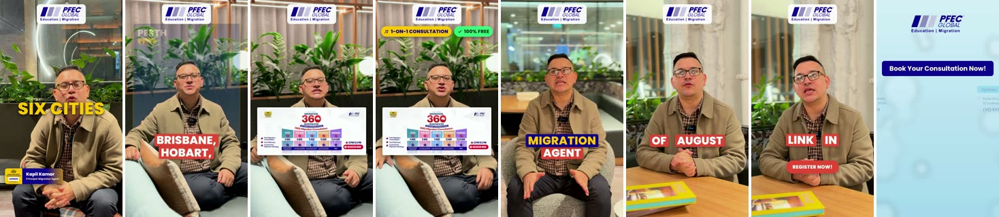 |
| 2026-07-24_redflag-greenflag-dm | 8 | 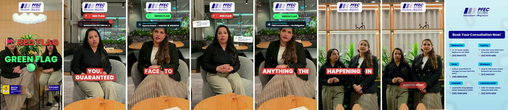 |
| 2026-07-27_kapil-tasmania-nomination | 9 | 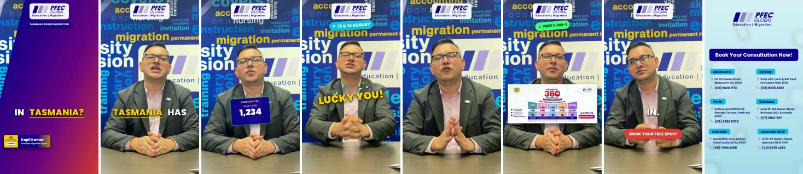 |
| 2026-07-27_tasmania-nomination-update | 9 | 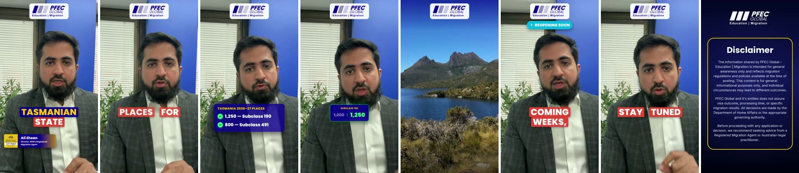 |
| 2026-07-28_kapil-adelaide | 9 (+ bg_swap, cyan) | (no render kept) |
| 2026-08-07_maheesha-just-ask-expo | 2 (countdown) | 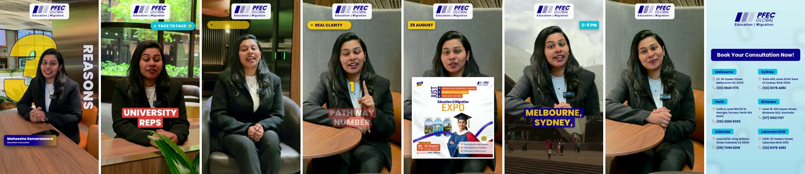 |
| 2026-08-11_tushar-melbourne-expo | 2 | 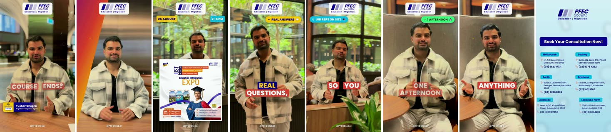 |
| 2026-08-13_salman-just-ask-expo | 2 | 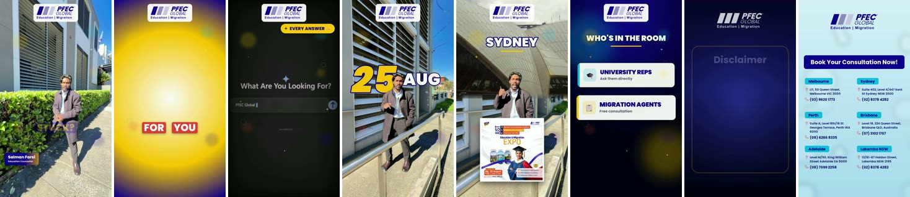 |
| 2026-08-14_salman-just-ask-expo-v2 | 2 | 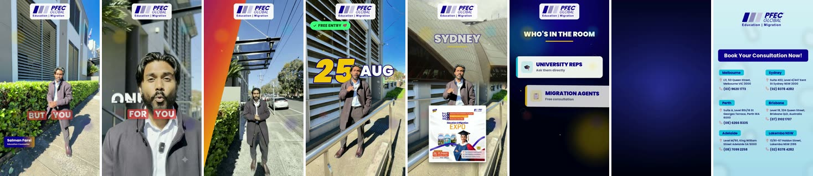 |
| 2026-08-14_salman-just-ask-expo-v3 | 2 | 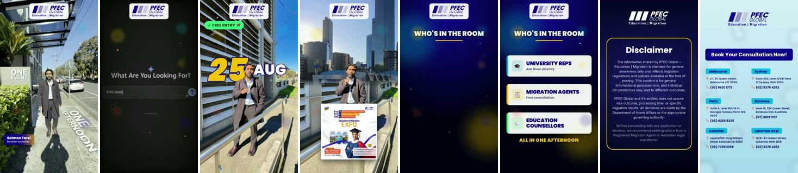 |
| 2026-08-19_tushar-choose-your-fighter | 7 | 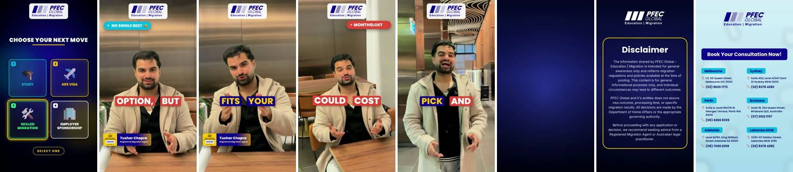 |
| 2026-08-20_migration360-roadshow-thankyou | 10 | 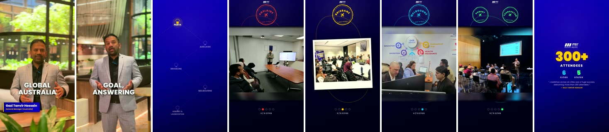 |
| 2026-09-02_maheesha-welcome-day-sinhala | 2 + bilingual | 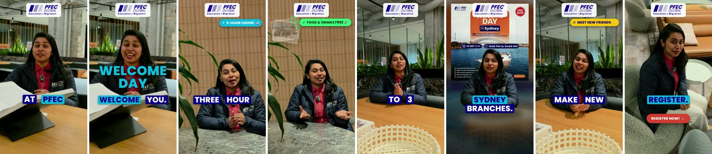 |
| 2026-10-05_rahul-visa-changes | 1 | 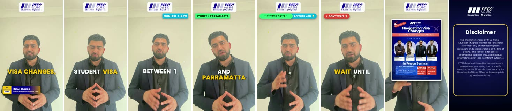 |
| 2026-10-05_rahul-visa-changes-hindi | 1 + bilingual | 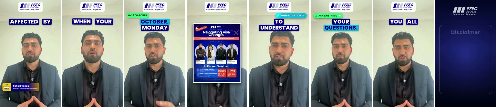 |
| 2026-10-05_tushar-visa-changes | 1 | 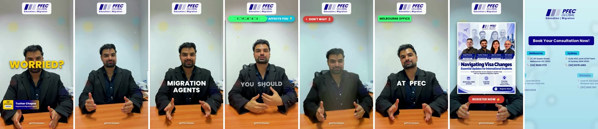 |
| 2026-10-06_visa-changes-hindi-desk | 1 + bilingual | 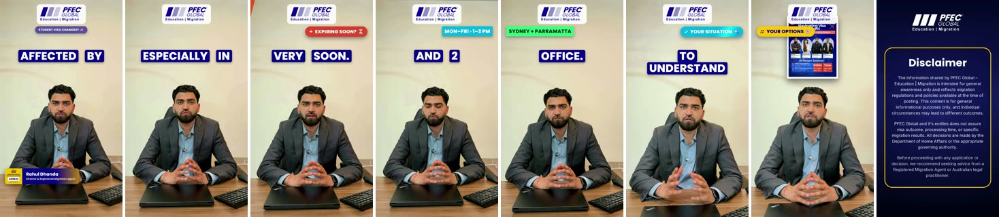 |
| 2026-10-12_tushar-fast | 3 | 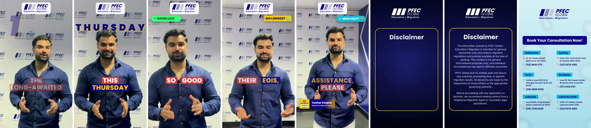 |
| 2026-10-15_rahul-189-round | 3 | 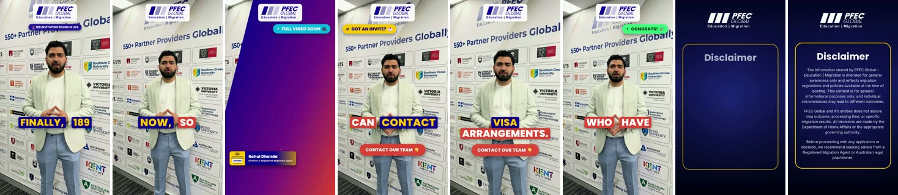 |
| 2026-10-16_rahul-reel | 4 | 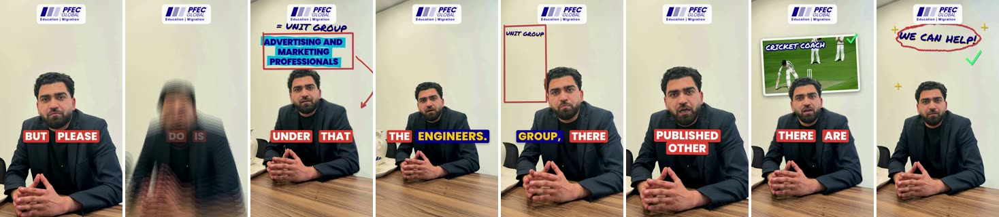 |
| 2026-10-21_pfec-brand-intro | 11 | 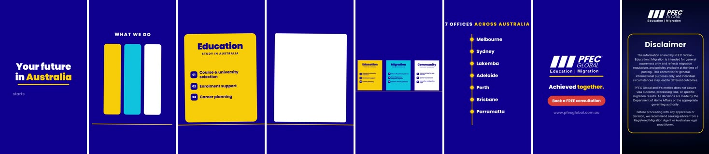 |
| 2026-10-21_rahul-img0082 | 4 | 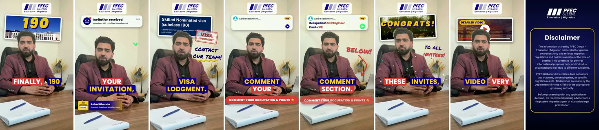 |
| 2026-10-23_rahul-split | 5 |  |
| 2026-10-23_tushar-split | 5 | 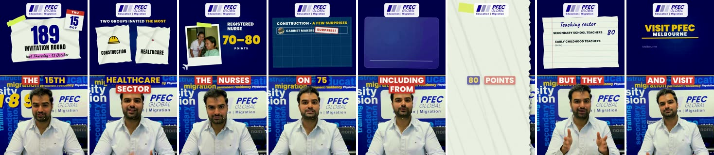 |
| 2026-10-28_tushar-explainer | 6 | 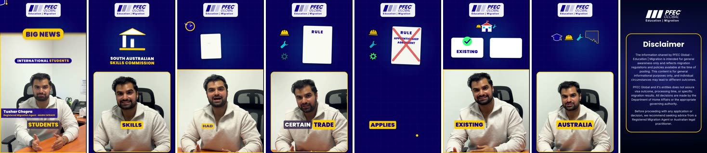 |
| 2026-11-05_apurva-employer-sponsorship | 6 | 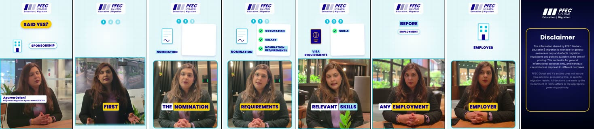 |

Not in git: `2026-10-30_migrationos-promo` (MigrationOS product promo; its
`scripts/` hold saved CRM login state, so it stays local-only).

**Keeping this current:** add a row (and a new type if it's genuinely new) as part
of the end-of-reel ritual in `/CLAUDE.md`, and make the contact sheet with:
`ffmpeg -i output/reel_final.mp4 -vf "fps=8/<dur>,scale=180:-2,tile=8x1:padding=4:color=white" -frames:v 1 docs/lessons/edit-catalog/<reel>.jpg`
